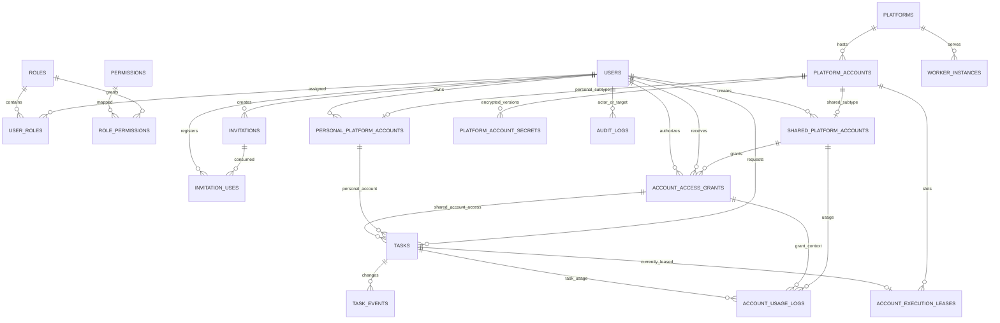

# 多平台学习管理系统：阶段二架构决策与基础后端

> 本文件合并 2026-10-31 已确认的账号模式、邀请码、Docker Compose、统一后端/独立 Worker 决策。阶段二只建设隔离基础后端、数据库和 Worker 合同；不接入真实平台、不开发正式前端、不部署生产环境。
> 原有平台项目保持只读；所有新代码位于 `unified_system/`。

## 0. 仓库和实施边界（已核实项）

- 当前固定分支：`arena/bd5e1acd-chaoxing`；Arena 控制当前分支名，本阶段不切换分支。
- 原始学习通、智慧树和英华目录没有被本阶段改写。阶段二是同仓库增量实现，并非另起一个无关项目。
- 英华 Go 候选源码仅在链接分支中看到 `pkg/yinghua`，缺 `go.mod`，没有完成 Linux 构建/行为验证；不可宣称英华已接入。
- 学习通和智慧树虽有旧项目代码，但均未接入新后端/Worker；平台目录状态仍为待接入。
- SQLite 用于本地开发与测试。PostgreSQL DDL 已生成，Alembic 在 SQLite 上验证；本阶段没有可用 PostgreSQL 实例，尚未做 PostgreSQL 实机迁移验证。
- 旧项目被跟踪配置中曾发现一个非空、疑似真实 AI Key；新系统不会加载或复用它。供应商侧撤销/轮换仍需系统所有者处理。

## 1. 系统总体架构

```text
                                   公网
浏览器 ── HTTPS ──► Nginx ──► Frontend（阶段三；阶段二暂由 Flask 提供静态壳）
                         │
                         └──► Backend/API（认证、RBAC、邀请码、账号/授权、任务调度、审计）
                                  │        私有 Compose 网络
                       ┌──────────┼──────────────┐
                       ▼          ▼              ▼
                 PostgreSQL    Redis*      内部 Worker API
              users/RBAC/账号   缓存/可选       ▲      ▲      ▲
              secrets/tasks     队列可选       │      │      │
                       ▲                  超星 Worker │      │
                       │                     知到 Worker     │
                       └──────── durable task state ─ 英华 Worker（源码审计后决定）
```

- **统一后端**：身份认证、授权检查、邀请码、个人/共享账号目录和秘密凭证加密、共享授权、任务生命周期、Worker 注册/心跳、审计和使用记录。
- **平台 Worker 独立部署**：每个平台独立进程/容器、独立凭证、健康心跳、超时/取消/状态回传；一个 Worker 故障不应阻塞其他平台。Worker 通过内网 HTTP 合同领取任务，不访问浏览器会话，也不能选择其他平台的任务。
- **队列选择**：阶段二使用 PostgreSQL 持久化 `tasks`，Worker 通过事务性 claim 轮询，PostgreSQL 使用任务行 `FOR UPDATE SKIP LOCKED` 和账号行锁分配账号槽位。Redis 目前不是必需依赖；如果实际吞吐/调度需要，再加入 Redis Streams/Celery 等队列，数据库仍保留最终任务状态。
- **Docker Compose**：已定为后续部署编排方式。生产拓扑包含 Nginx、Frontend、Backend、PostgreSQL、按需 Redis 和独立平台 Worker；PostgreSQL、Redis、Worker API 只在私有网络，不映射公网端口。生产 HTTPS、备份、监控和日志策略留阶段六。本阶段沙箱没有 Docker/Compose 可执行文件，故未声称 Compose 构建或容器联调通过。
- **网络边界**：公网 Nginx 只暴露 Web/API；生产 Nginx 必须拒绝转发 `/api/internal/workers/*`。Worker 只使用私网 backend DNS，并持有平台专属 `WORKER_TOKEN_*`；不复用用户会话或共享平台密码。

## 2. 数据库 ER 图



### 2.1 核心表和归属

| 表 | 关键列/关系 | 设计要点 |
|---|---|---|
| `users` | 用户主键、邮箱、Argon2id 密码哈希、状态、`auth_version` | 账号停用而非物理删除；停用时撤销会话版本。 |
| `roles`, `permissions`, `user_roles`, `role_permissions` | 多对多 RBAC | 超管权限由后端策略判定；前端显隐不是授权边界。 |
| `admin_user_scopes` | `admin_id`, `user_id` 复合主键 | 普通管理员只管理授权用户；授权由超管控制。 |
| `invitations`, `invitation_uses` | 邀请码哈希、过期、最大/当前次数、禁用时间、消费关系 | 注册端对有效性做条件原子更新；`used_count <= max_uses` 数据库约束；原文仅签发时显示。 |
| `platforms` | 平台键、认证方法、能力、接入状态 | 状态由后端维护；未验证平台保持 `pending`。 |
| `platform_accounts` | 账号 ID、平台、标签、账号状态 | 仅共享非敏感共性字段；所有权不放在一个“类型/所有者”字段里混用。 |
| `personal_platform_accounts` | `account_id`、`owner_user_id`、平台、掩码提示 | 独立个人子表；复合唯一键 `(account_id, owner_user_id)`，任务复合外键强制请求人必须是 owner。 |
| `shared_platform_accounts` | `account_id`、`created_by`、开关、起止时间、`max_concurrency` | 独立共享子表；管理员拥有管理权；账号状态/可用时间与授权状态分开。 |
| `platform_account_secrets` | `account_id`、认证方式、版本、密文、撤销状态 | 密文与账号元数据分表；Fernet envelope 加密；普通 API 和管理员列表永不回显。仅通过 Worker 成功领取的内网响应短暂交付凭证。 |
| `account_access_grants` | 共享账号、用户、授权人、有效区间、撤销时间、范围 JSON | 每次授权保留独立历史行；部分唯一索引限制同账号/用户仅一个未撤销授权；任务复合外键必须引用同一用户的 grant。 |
| `tasks` | 请求用户、个人账号或共享账号+grant 二选一、状态、超时、幂等键、Worker/lease 信息 | CHECK 约束只允许个人/共享其中一种；状态机和任务状态查询均以后端为准。凭证不得放入 `request_data`。 |
| `task_events` | task/user 复合外键、事件类型、脱敏 JSON、时间 | 只记录状态和短代码，不记录凭证、Cookie、Token。 |
| `account_execution_leases` | `(account_id, slot_no)` 主键、唯一活动 `task_id`、Worker、lease token 哈希和到期时间 | 跨 Backend/Worker 进程的持久化并发槽位；账号行锁串行分配。默认每账号一个并发槽。 |
| `account_usage_logs` | 共享账号、grant、用户、任务复合外键、事件和脱敏元数据 | 可追溯授权/排队/占用/完成/撤销，不包含明文秘密；只由该共享账号管理者/超管读取。 |
| `worker_instances` | 平台、唯一 Worker ID、版本、能力、心跳 | 心跳过期按离线处理；每个平台独立身份和 token。 |
| `audit_logs` | 操作者、目标用户、动作、实体、脱敏元数据 | 系统管理审计；非授权范围不可读。 |
| `login_logs`, `password_reset_tokens` | 登录事件/重置 token 哈希 | 失败限速；只存重置 token 哈希。 |
| `ai_provider_configs`, `ai_usage_logs` | 配置/用量预留表 | 当前无 Provider API/密钥复用。 |

### 2.2 字段级数据结构（SQLAlchemy 类型映射）

| 表 | 字段 |
|---|---|
| `users` | `id CHAR(32) PK`, `email VARCHAR(320) UNIQUE`, `display_name VARCHAR(120)`, `password_hash VARCHAR(512)`, `status VARCHAR(24)`, `auth_version INT`, `created_at/updated_at DATETIME`, `last_login_at DATETIME NULL` |
| `roles` / `permissions` | `id CHAR(32) PK`, `name VARCHAR(40/80) UNIQUE`, `description VARCHAR(200)` |
| `user_roles` / `role_permissions` | 两个 FK 构成复合主键，均 `ON DELETE CASCADE` |
| `invitations` | `id`, `code_hash CHAR(64) UNIQUE`, `code_hint VARCHAR(12)`, `created_by FK users`, `created_at`, `expires_at`, `max_uses INT`, `used_count INT`, `revoked_at NULL`, `note VARCHAR(200)` |
| `invitation_uses` | `id`, `invitation_id FK`, `user_id FK`, `used_at`; `UNIQUE(invitation_id,user_id)` |
| `platforms` | `id`, `key VARCHAR(48) UNIQUE`, `name VARCHAR(100)`, `code_available BOOL`, `integration_status VARCHAR(24)`, `auth_methods JSON`, `capabilities JSON`, `last_verified_at NULL`, `status_note TEXT` |
| `platform_accounts` | `id`, `platform_id FK`, `account_mode VARCHAR(16)`, `label VARCHAR(120)`, `status VARCHAR(24)`, `created_at`, `updated_at`; account mode 只作类型完整性标记，owner 仍分存在个人/共享子表 |
| `personal_platform_accounts` | `account_id PK/FK`, `account_mode='personal'`, `owner_user_id FK users`, `platform_id FK-composite`, `account_hint VARCHAR(120)`（服务端强制掩码）, `created_at` |
| `shared_platform_accounts` | `account_id PK/FK`, `account_mode='shared'`, `created_by FK users`, `account_hint VARCHAR(120)`（掩码）, `is_open BOOL`, `available_from NULL`, `expires_at NULL`, `max_concurrency INT`, `created_at` |
| `platform_account_secrets` | `id`, `account_id FK`, `created_by FK users NULL`, `auth_type VARCHAR(32)`, `ciphertext TEXT`, `version INT`, `status VARCHAR(24)`, `created_at`, `revoked_at NULL` |
| `account_access_grants` | `id`, `shared_account_id FK`, `user_id FK`, `granted_by FK`, `valid_from`, `expires_at NULL`, `revoked_at NULL`, `scope JSON`（当前允许 `task_kinds`）, `created_at` |
| `tasks` | `id`, `user_id FK`, `personal_account_id NULL`, `shared_account_id NULL`, `access_grant_id NULL`, `kind VARCHAR(48)`, `status VARCHAR(24)`, `request_data JSON`, `idempotency_key VARCHAR(128) NULL`, `timeout_seconds INT`, `attempt/max_attempts INT`, `worker_id NULL`, `lease_expires_at NULL`, `cancel_requested_at NULL`, `result_summary JSON`, `error_code NULL`, `created_at/started_at/finished_at` |
| `task_events` | `id`, `task_id`, `user_id FK`, `event_type VARCHAR(48)`, `details JSON`（脱敏）, `created_at`; task+user 复合 FK |
| `account_usage_logs` | `id`, `shared_account_id`, `grant_id`, `user_id`, `task_id`, `event_type VARCHAR(48)`, `details JSON`（脱敏）, `created_at`; 复合 FK 验证 grant/task/user/account 同属一组 |
| `account_execution_leases` | `account_id FK`, `slot_no INT` 复合 PK, `task_id FK UNIQUE NULL`, `lease_token_hash CHAR(64) NULL`, `worker_id NULL`, `acquired_at/heartbeat_at/expires_at NULL` |
| `worker_instances` | `id`, `platform_id FK`, `worker_id VARCHAR(120) UNIQUE`, `version VARCHAR(80)`, `status VARCHAR(24)`, `capabilities JSON`, `last_seen_at NULL`, `created_at` |
| `audit_logs` | `id`, `actor_user_id FK NULL`, `target_user_id FK NULL`, `action VARCHAR(80)`, `entity_type VARCHAR(48)`, `entity_id VARCHAR(64)`, `metadata_json JSON`（脱敏）, `created_at` |
| `login_logs` | `id`, `user_id FK NULL`, `identifier VARCHAR(320)`, `remote_fingerprint CHAR(64)`, `result VARCHAR(24)`, `user_agent VARCHAR(256)`, `created_at` |
| `password_reset_tokens` | `id`, `user_id FK`, `token_hash CHAR(64) UNIQUE`, `created_by FK NULL`, `created_at`, `expires_at`, `used_at NULL` |
| `admin_user_scopes` | `admin_id FK`, `user_id FK`, `created_at`; 两列复合 PK 且禁止自授权 |
| `ai_provider_configs` / `ai_usage_logs` | 配置表含 `owner_user_id`, `provider`, `endpoint`, `model`, `secret_ciphertext`, `enabled`, timestamps；用量表含 `user_id`, provider/model/purpose/status/token counts/created_at，暂不提供 Provider API |

### 2.3 索引与强约束

- 唯一索引：用户邮箱、平台键、邀请哈希、邀请码 `(invitation_id,user_id)` 消费、用户任务幂等 `(user_id,idempotency_key)`、账号密钥版本、Worker ID、grant ID/account/user。
- 部分唯一索引：`account_access_grants(shared_account_id,user_id) WHERE revoked_at IS NULL`；重授权前将已过期旧授权标记为撤销。PostgreSQL 与 SQLite DDL 都导出此约束。
- 热查询索引：任务 `(status,created_at)` 队列、`(user_id,created_at)` 用户查询、任务事件 `(task_id,created_at)`、账号 grant `(shared_account_id,user_id,revoked_at)`、使用记录 `(shared_account_id,created_at)`、lease `expires_at`、Worker `platform_id/last_seen_at`。
- 所有权外键：`tasks(personal_account_id,user_id) → personal_platform_accounts(account_id,owner_user_id)`；共享任务 `tasks(access_grant_id,shared_account_id,user_id) → account_access_grants(id,shared_account_id,user_id)`；共享使用日志再复合引用 grant 和 task。数据库层因此拒绝跨用户/跨 grant 关联，而非只依赖 UI。
- SQLite 测试连接显式打开 `PRAGMA foreign_keys=ON`。生产 PostgreSQL 事务隔离、行锁、部分索引和 `SKIP LOCKED` 为 Worker 跨进程调度的目标实现，需阶段六实机迁移/并发演练再验收。

## 3. 账号归属、共享授权、撤销和并发策略

### 3.1 个人账号

- 普通用户通过个人账号 API 创建、重新授权或解绑；`personal_platform_accounts.owner_user_id` 是唯一所有者。
- 账号凭证只写入 `platform_account_secrets.ciphertext`，密钥来自生产 Secret Manager；返回对象只有掩码提示和状态。管理员（包括超管）无明文读取 API。
- 新建/重新授权状态为 `unverified`。当前没有平台认证适配器，因此系统不会谎报验证成功，也不会允许该账号创建可执行任务。
- 解绑是保留审计的软禁用：撤销密钥、立即取消队列任务、运行中任务转 `cancel_requested`，账号/历史任务保留供审计。

### 3.2 管理员共享账号

- `shared_platform_accounts.created_by` 明确创建/管理主体。超管可全局管理；普通管理员只能管理自己创建的共享账号。
- 用户访问必须同时满足：grant 未撤销、已到 `valid_from`、未过期、账号已开放、未超过账号/授权有效期、用户为 active、任务类型在 grant scope 内。用户列表只返回被授权且开放的账号及掩码提示。
- 普通管理员只可给自己 `admin_user_scopes` 中的普通用户授权；超管可为任意普通用户授权。管理员可以按账号设置开放状态、有效期限、并发上限、范围，查看使用记录并撤销 grant。
- 撤销 grant 后立即拒绝新任务；排队任务改 `cancelled`；已领取/执行任务改 `cancel_requested`，Worker 收到取消并确认后释放锁。超管和管理员都不能通过普通管理 API 读取共享账号密文。
- 共享账号禁用/关闭：立即拒绝新任务并取消排队任务；运行任务请求取消。凭证不直接删除，重新授权将生成新密钥版本，状态回到 `unverified`；必须重新完成真实平台验证才能成为 active。

### 3.3 用户禁用

- 禁止新登录/新任务；`auth_version` 增加使旧会话失效。若目标为管理员，同时清空其管理 scope；重新启用后由超管重新分配。
- 撤销该用户所有共享账号授权，取消其排队任务，通知其运行任务取消。
- 个人账号及密文历史不物理删除；账号状态置为 disabled、秘密撤销。超管重新启用用户后，仍需重新授权/验证账号。
- 被禁用管理员创建的共享账号关闭并禁用，相关授权/任务同样失效。恢复管理员不自动重新开放账号或复活授权，须由超管重新审查。
- 用户主记录以 disable/tombstone 保留，外键策略禁止误级联删除账务/审计关系。

### 3.4 同账号并发和隔离

- 每个 `platform_accounts` 有账号级租约槽，默认 `max_concurrency=1`；同平台账号的任务先持久入队，Worker 领取时在事务内锁定账号父行，再分配空闲/过期槽位，防止多个 Worker 同时覆盖一个登录会话。
- 即使管理员配置并发大于 1，只有平台目录有经验证能力 `parallel_account_sessions_verified` 时调度器才使用多槽；否则有效上限强制为 1。
- lease token 只存哈希；每次续租更新心跳和到期时间；过期/取消后旧 token 被 fencing，旧 Worker 的状态回传返回 409。Worker 必须遵守 lease deadline、任务超时和取消检查；未收到确认时保持账号槽直到 TTL 到期，不提前释放给下一项任务。
- Postgres 行锁用于多个 Backend/Worker 副本；SQLite 仅保证开发/测试数据约束，不作为多进程生产调度器。

## 4. 用户权限矩阵

| 操作 | 超级管理员 | 普通管理员 | 普通用户 | 平台 Worker |
|---|---|---|---|---|
| 用户/角色/管理范围 | 全局；不能读明文平台凭证 | 仅管理授权 scope 内用户；不能改系统角色/授权范围 | 仅本人个人资料/密码 | 无权 |
| 邀请码 | 创建/批量/查询/禁用/查看消费 | 无（可按后续授权细分） | 注册时使用一次/按限次 | 无权 |
| 个人平台账号 | 只管理自己的个人账号 | 只管理自己的个人账号 | 只读写/重授权/解绑本人账号 | 仅成功租约时获得该任务凭证 |
| 共享账号 | 全局创建/开放/期限/并发/授权/撤销/使用记录 | 只管理自己创建的账号；授权用户必须在管理 scope | 只看开放且授予本人的掩码账号；无密文访问 | 只领取自身平台任务；只在租约下获得凭证 |
| 任务 | 默认只读系统审计，不可冒充用户提交 | 自己提交/查看本人任务；用户管理操作受 scope | 创建、查看、取消本人任务 | 领取/心跳/状态回传；只操作自己平台/worker_id/lease |
| 系统审计/登录记录 | 全局 | 授权范围和自身记录 | 仅本人认证数据（后续页面） | 无权 |
| 共享账号使用记录 | 全局 | 自己创建账号的记录 | 不可读他人 usage log | 只产生租约相关事件，无权查询 |

**敏感信息原则：** 管理权限不是查看密码、Cookie、Token 的权限。Worker 是唯一可能取得运行所需明文凭证的后端服务，必须先通过专属 Worker token、平台匹配、有效任务租约和账号授权检查；网络只走 Compose 私网。任何普通 API、审计、Worker 日志和任务事件均不写明文秘密。

## 5. API 接口清单

所有用户写接口要求 HttpOnly SameSite 会话、CSRF 和对应 RBAC；对象读取在数据库/API 层按 owner/grant/scope 过滤。

### 5.1 认证与目录

| 方法 | 路径 | 权限/说明 |
|---|---|---|
| GET | `/api/v1/health` | 公共健康探针，不返回配置/凭据 |
| POST | `/api/v1/auth/register` | 有效邀请码；限时/限次校验与消费计数条件更新 |
| POST/GET | `/api/v1/auth/login`, `/api/v1/auth/me` | Argon2id、失败节流、本人角色/CSRF |
| POST | `/api/v1/auth/logout` | 登录 + CSRF |
| PATCH/POST | `/api/v1/auth/profile`, `/api/v1/auth/password` | 仅本人；密码更改撤销旧会话 |
| POST | `/api/v1/auth/reset-password` | 一次性重置 token 的哈希匹配 |
| GET | `/api/v1/platforms` | 登录后返回平台真实目录/验证状态 |

### 5.2 邀请码、用户、共享账号管理

| 方法 | 路径 | 权限/说明 |
|---|---|---|
| GET/POST | `/api/v1/admin/invitations` | 超管生成单个/批量、到期/最大次数；只返回一次原码 |
| POST | `/api/v1/admin/invitations/{id}/disable` | 禁用邀请码 |
| GET | `/api/v1/admin/invitations` | 查询计数、状态、提示，不显示原码 |
| GET | `/api/v1/admin/invitations/{id}/uses` | 查询该邀请码的消费用户与时间 |
| GET | `/api/v1/admin/users` | 超管全量；普通管理员只看已授权用户 |
| PATCH | `/api/v1/admin/users/{id}/status` | scope 检查；禁用时撤销账号授权/会话并取消任务 |
| POST | `/api/v1/admin/users/{id}/reset-link` | scope 检查；短时一次性链接只显示一次 |
| POST | `/api/v1/admin/users/{id}/roles` | 仅超管；禁止经普通接口移除超管身份 |
| GET/POST | `/api/v1/admin/scopes` | 仅超管查询/授予普通管理员用户范围 |
| DELETE | `/api/v1/admin/scopes/{admin_id}/{user_id}` | 仅超管撤销范围 |
| GET/POST | `/api/v1/admin/shared-accounts` | 管理者创建/列出自己账号；超管全局；写入密文，不回显凭证 |
| PATCH | `/api/v1/admin/shared-accounts/{id}` | 管理开关、到期、并发和禁用状态；不能手工伪造 `active` |
| POST | `/api/v1/admin/shared-accounts/{id}/reauthorize` | 轮换/重新提交密文并重回 `unverified` |
| POST | `/api/v1/admin/shared-accounts/{id}/grants` | 给普通用户授权，可设有效期和 `task_kinds` 范围 |
| POST | `/api/v1/admin/shared-accounts/{id}/grants/{grant_id}/revoke` | 撤权并请求运行任务取消 |
| GET | `/api/v1/admin/shared-accounts/{id}/usage` | 只限账号管理者/超管；脱敏使用记录 |
| GET | `/api/v1/admin/platform-workers` | 超管查看按心跳时效计算的平台 Worker 在线状态 |
| GET | `/api/v1/admin/audit-logs`, `/api/v1/admin/login-logs` | 超管全局；管理员限 scope |

### 5.3 个人账号、用户共享账号视图、任务

| 方法 | 路径 | 权限/说明 |
|---|---|---|
| GET | `/api/v1/platform-accounts` | 返回本人个人账号与本人当前有效的共享账号；不含 secrets |
| POST | `/api/v1/personal-accounts` | 创建本人账号/加密秘密；状态未验证 |
| POST | `/api/v1/personal-accounts/{id}/reauthorize` | 所有者提交新授权信息，旧密文撤销，状态未验证 |
| DELETE | `/api/v1/personal-accounts/{id}` | 所有者解绑；软禁用、撤销密文、取消任务 |
| GET | `/api/v1/shared-accounts` | 只返回开放且当前 grant 有效的共享账号掩码信息 |
| POST | `/api/v1/tasks` | 个人账号 owner 或有效共享 grant；平台/账号未激活时拒绝创建 |
| GET | `/api/v1/tasks` | 当前用户自己的任务，限量分页基础版 |
| GET | `/api/v1/tasks/{id}` | 当前用户任务及状态事件；他人 ID 返回 404 |
| POST | `/api/v1/tasks/{id}/cancel` | 本人取消；排队即取消，运行中转取消请求 |

### 5.4 内部 Worker 合同（不经公网 Nginx）

| 方法 | 路径 | 说明 |
|---|---|---|
| POST | `/api/internal/workers/heartbeat` | `X-Worker-Platform/ID/Token`；登记/刷新心跳与能力 |
| POST | `/api/internal/workers/claim` | 仅本平台在线 Worker；原子领取任务/账号租约；仅在响应体短暂返回该任务解密凭证 |
| POST | `/api/internal/workers/{task_id}/start` | 需有效 lease token，`leased → running` |
| POST | `/api/internal/workers/{task_id}/heartbeat` | 延长有效租约；返回是否已请求取消；超时后停止续租 |
| POST | `/api/internal/workers/{task_id}/complete` | 需有效租约；回传 `succeeded/failed/cancelled`、限长脱敏结果并释放租约 |

### 5.5 当前状态

阶段二已经实现上述用户/邀请码/RBAC、账号数据模型、个人账号加密写接口、共享授权和管理 API、任务 CRUD/取消骨架、内部 Worker 心跳/领取/租约/状态回传 API。由于真实平台 Worker 尚不存在、平台目录均为 pending，账号保持 `unverified`；普通任务 API 因未验证而拒绝下发，不能用模拟结果伪装平台已接入。

## 6. Worker 协议与任务状态机

### 6.1 任务信封

Worker `claim` 成功响应包含：

```json
{
  "task": {
    "id": "opaque-task-id",
    "user_id": "owner-user-id",
    "platform_key": "chaoxing",
    "platform_account_id": "opaque-account-id",
    "kind": "course_sync",
    "request_data": {"course_id": "..."},
    "attempt": 1,
    "timeout_seconds": 900,
    "lease_token": "one-time-random-fencing-token",
    "lease_expires_at": "UTC timestamp"
  },
  "credential": {"auth_type": "...", "values": {"...": "decrypted only for this internal response"}}
}
```

- 鉴权头：`X-Worker-Platform`、`X-Worker-ID`、`X-Worker-Token`。每个平台配置独立随机 token；Worker ID 不能跨平台重用。
- 接口接受/回传字段有大小限制；明文凭证不进入 task request、事件、usage、审计、错误文本或访问日志。Worker 必须自行脱敏日志和异常。
- `lease_token` 仅存 SHA-256 哈希；每次心跳延长 TTL（默认 60 秒），Worker 心跳默认 90 秒视为在线窗口。
- Worker 只领取 `platform_key` 对应的任务；任务 claim 需要平台 integration active、账号 active、用户 active、grant 有效、Worker 近期心跳和可用账号槽。

### 6.2 状态转换

```text
queued ──claim──► leased ──start──► running ──complete──► succeeded / failed
  │                  │                │
  ├─user/admin cancel┴────────────────┴──► cancel_requested ──ack──► cancelled
  │
  └────────────────────────────────────────────────────────────► cancelled
leased/running ──超时或租约失效且 Worker 不再续租──► timed_out/cancelled
```

所有转移写 `task_events`。取消中的工作不会立即释放账号槽；Worker 确认取消才释放，或 lease 到期后旧 token 被 fencing。Worker 进程错误由平台隔离；其任务失败/到期只影响对应 Worker/账号，不会同步终止其他平台 Worker。后续上线时每个平台适配器必须补充真实超时、协作取消、健康探针与回归测试。

## 7. 阶段二开发任务清单与后续阶段

### 阶段二：当前实现范围

1. ✅ 最终架构与账号模式决策整合到本文。
2. ✅ ER、所有者/授权关系、索引与状态策略。
3. ✅ SQLAlchemy schema、PostgreSQL DDL 导出、Alembic 初始化迁移。
4. ✅ 注册/登录、邀请码原子计数、Argon2id、登录限速、会话撤销。
5. ✅ RBAC、管理范围、CSRF、服务端对象级授权。
6. ✅ 个人/共享平台账号模型、密文表、授权/撤销/有效期/范围 API。
7. ✅ 共享账号使用记录和账号级并发 lease 模型。
8. ✅ 持久化任务状态、task events、账号所有权复合外键、用户取消/禁用处理。
9. ✅ 平台隔离的 Worker 心跳、claim、start、lease heartbeat、complete 合同。
10. ✅ 安全基础、服务端错误/敏感值保护、审计、后端测试环境。
11. ⏸ Docker Compose 开发环境可选；本沙箱无 Docker CLI，未执行构建。

### 后续阶段（不在本阶段伪装完成）

- **阶段三**：正式前端工作台（Dashboard、平台中心、个人账号、共享账号、授权管理、邀请码、用户管理、个人中心）。
- **阶段四**：逐平台接独立 Worker：学习通优先、智慧树其次；英华只有源码/许可证/依赖审计和 Linux 实测通过后再定。
- **阶段五**：AI 学习辅助 Provider；密钥服务端加密、额度审计，只做学习支持，不代答/代提交。
- **阶段六**：Docker Compose 生产部署、Nginx/HTTPS、真实 PostgreSQL 并发迁移与 Worker 压测、服务器安全、备份恢复演练、监控和日志保留。

## 8. 迁移与升级策略

- `unified_system/migrations/versions/0001_initial.py` 是**未生产部署前的阶段二 schema baseline**，应在空数据库执行；其后所有生产变更需追加新的、不可变的 Alembic revision，禁止再改已部署 revision。
- 本轮原有 SQLite demo/开发库不是生产数据，不会作为迁移源；当前新 baseline 已加入明确的账号子类型、grant、lease、usage 和 Worker 表。真实升级前需在阶段六使用空 PostgreSQL 和上一正式 baseline 做升级/回滚演练。
- `unified_system/postgresql-schema.sql` 为模型导出的 PostgreSQL DDL 参考，不替代 Alembic 迁移。生产启动不执行 `create_all`；备份数据库与 Fernet/KMS 密钥分别保护，密钥丢失会导致密文不可恢复。
